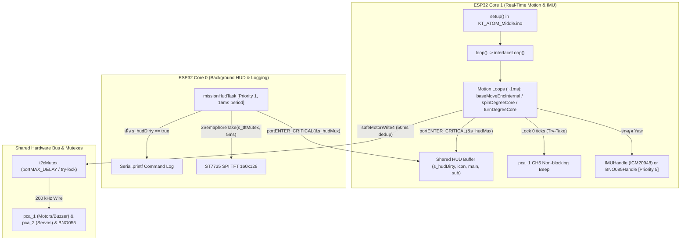

# คู่มือเทคนิคและสรุปการทำงานระบบ KT_ATOM_Middle ฉบับสมบูรณ์

**แพลตฟอร์ม:** PTBOT Atom VX (ESP32 Dual-Core @ 240 MHz)  
**ไลบรารีจัดการบอร์ด:** `KT_ATIOM_VX_MANAGER` v1.0.0 บน `PTBOTAtomVX` v1.1.6 (`PTBOT_ESP32` Core v1.1.7)  
**สภาพแวดล้อมพัฒนา:** Arduino IDE 2.x / KT Middle IDE v3.0.0 (Vite + Node.js + `arduino-cli`)

> [!NOTE]
> เอกสารฉบับนี้รวบรวมและสรุปการทำงานของระบบ **KT_ATOM_Middle** ทั้งหมดจากซอร์สโค้ดจริงในโปรเจกต์ ครอบคลุมโครงสร้างไฟล์ทุกไฟล์ สถาปัตยกรรม Dual-Core FreeRTOS ฮาร์ดแวร์และไลบรารี ความละเอียดมอเตอร์และเซนเซอร์ สมการคณิตศาสตร์ที่ใช้ควบคุมการเคลื่อนที่ พารามิเตอร์ทั้งหมดใน `Config.ino` แผนที่ Flash NVS คู่มือคำสั่ง API ทุก Overload ระบบ TFT UI / Assembly Mode / Auto-Tune ภารกิจปัจจุบัน และระบบนิเวศ IDE/Plugin

---

## สารบัญ

1. [ภาพรวมระบบ โครงสร้างไฟล์ทั้งหมด และสถาปัตยกรรม Dual-Core FreeRTOS](#1-ภาพรวมระบบ-โครงสร้างไฟล์ทั้งหมด-และสถาปัตยกรรม-dual-core-freertos)
2. [รายละเอียดฮาร์ดแวร์และไลบรารี (KT_ATIOM_VX_MANAGER + PTBOTAtomVX)](#2-รายละเอียดฮาร์ดแวร์และไลบรารี-kt_atiom_vx_manager--ptbotatomvx)
3. [ความละเอียดมอเตอร์ Encoder เซนเซอร์ และมิติเชิงกล](#3-ความละเอียดมอเตอร์-encoder-เซนเซอร์-และมิติเชิงกล)
4. [สมการการคำนวณและอัลกอริทึมควบคุมการเคลื่อนที่ทั้งหมด](#4-สมการการคำนวณและอัลกอริทึมควบคุมการเคลื่อนที่ทั้งหมด)
5. [ตารางพารามิเตอร์ทั้งหมดใน Config.ino และแผนที่หน่วยความจำ Flash NVS](#5-ตารางพารามิเตอร์ทั้งหมดใน-configino-และแผนที่หน่วยความจำ-flash-nvs)
6. [คู่มือคำสั่ง API ครบทุกฟังก์ชันและทุก Overload](#6-คู่มือคำสั่ง-api-ครบทุกฟังก์ชันและทุก-overload)
7. [ระบบหน้าจอ TFT UI, Assembly Mode และ Auto-Tune](#7-ระบบหน้าจอ-tft-ui-assembly-mode-และ-auto-tune)
8. [สรุปภารกิจปัจจุบัน (RunMode1–3) และระบบนิเวศ KT Middle IDE & Plugins](#8-สรุปภารกิจปัจจุบัน-runmode13-และระบบนิเวศ-kt-middle-ide--plugins)

---

## 1. ภาพรวมระบบ โครงสร้างไฟล์ทั้งหมด และสถาปัตยกรรม Dual-Core FreeRTOS

### 1.1 โครงสร้างไฟล์ทั้งหมดในโปรเจกต์

| หมวดหมู่ | พาธไฟล์ | หน้าที่การทำงานหลัก |
| :--- | :--- | :--- |
| **Firmware หลัก** | `KT_ATOM_Middle.ino` | จุดเริ่มต้นโปรแกรม (`setup()`, `loop()`), ตั้ง Priority Task IMU, ตั้งโหมด BNO055, Setup Encoder, เปิด Code Defaults, โหลด Flash NVS, ตั้ง Servo Lock, เข้าสู่ UI |
| **ตัวแปรกลาง** | `Variables.ino` | ประกาศตัวแปรกลางสำหรับภารกิจและ Blocks Mode (`int speed = 100;`) |
| **ศูนย์ตั้งค่า & Flash** | `Config.ino` | ศูนย์รวมค่า PID, พารามิเตอร์การเดิน/หมุน/เลี้ยว/ตีโค้ง, ตาราง Box 1–8 ช่อง, ค่า Calibration เซนเซอร์/เซอร์โว/Encoder, ระบบ Snapshot `enableCodeMotionDefaults()`, NVS Flash (`kt_robot`), Serial `GET_CAL`/`?` |
| **มอเตอร์ & Encoder** | `Motor.ino` | 4-Wheel Speed Balance PI (`50 ms`), Safe I2C Motor Write พร้อม Dedup `50 ms`, Motor Trim, แปลงระยะ Box/Field CM -> Robot CM -> Ticks, อ่าน Encoder 4 ตัว, Servo `DropF/B`, Line Sensor Mapping (`0..100`) |
| **แกนเคลื่อนที่หลัก** | `Move.ino` | Core 0 `MissionHUD` Task, Non-blocking Buzzer, Turn Carry & Flow Continuity, `STOP()`, `moveForward`/`moveBackward` PD, `BaseFFE`/`baseBBE`/`FFE`/`BBE`/`FFE_turn`/`BBE_turn`, `FC`/`BC`/`FC4`/`BC4`/`FC_BOX`/`BC_BOX`, `FF`/`BB`/`FF_turn`/`BB_turn`, `SetFront*`/`SetBack*`/`SetF`/`SetB`/`DropF(spd)`/`DropB(spd)` |
| **หมุน & ตีโค้ง** | `SpinTurn.ino` | `spinDegree`/`SpinDegree`, `turnDegreeFront`/`TrunDegreeFront`, `turnDegreeBack`/`TrunDegreeBack`, `TTF90`/`TTF45`/`TTB90`/`TTB45`, และระบบ `autoTuneSpinAndTurn()` |
| **หน้าจอ & เมนู** | `Interface.ino` | UI 3 ส่วนบนจอ ST7735 160x128 (Top Bar / Content / Bottom Bar), ไอคอนคำสั่ง Active Command 14 แบบ, Ready-to-Run Screen, Assembly Mode 6 เมนูย่อย, `executeMission()` |
| **ภารกิจโหมด 1–3** | `RunMode1.ino`, `RunMode2.ino`, `RunMode3.ino` | ฟังก์ชันภารกิจ `runMode1()`..`runMode3()` แยกเป็น `Box1..4` + `EndMission` (โหมด 2–3 ใช้ prefix `M2_` / `M3_`) |
| **ตัวอย่างคำสั่ง** | `Examples.ino` | ฟังก์ชัน `examples()` รวมตัวอย่าง syntax และ Overload ทุกตัวสำหรับอ้างอิงและตรวจสอบคอมไพล์ (ไม่ถูกเรียกใช้งานจริง) |
| **Custom Library** | `libraries/KT_ATIOM_VX_MANAGER/` | ไลบรารี `KT_ATIOM_VX_MANAGER` v1.0.0 (`src/KT_ATIOM_VX_MANAGER.h`, `.cpp`, `KT_Logo.h`, `keywords.txt`, `library.properties`, `examples/BasicTest/BasicTest.ino`, `.zip`) |
| **IDE & Backend** | `ide/` | KT Middle IDE v3.0.0 (Vite + Node.js): Launcher (`start-ide.bat`, `start-ide.sh`, `manage-ide.bat`), คู่มือ (`README.md`, `USER_MANUAL_IDE.md`), แอปเว็บ (`app/src/`, `app/backend/apiMiddleware.js`) |
| **Plugin แก้สนาม** | `extentions-plugins/field-solver/` | ปลั๊กอิน Field Solver & Path Planner (`plugin.json`, `app.js`, `solver.js`, `codegen.js`, `simBridge.js`, `index.html`, `styles.css`) เชื่อมต่อสถานะผ่าน `.kt-plugins.json` |
| **เอกสาร & พรีวิว** | `README.md`, `preview/ui_preview.html`, `user_manual/KT_ATOM_VX_User_Manual.pdf` | คู่มือเริ่มต้น, พรีวิว UI, และคู่มือ PDF เดิมของบอร์ด |

---

### 1.2 สถาปัตยกรรม Dual-Core FreeRTOS และการป้องกัน Resource ร่วมกัน

ระบบแยกงานควบคุมมอเตอร์ความถี่สูงออกจากงานวาดจอ TFT และส่ง Serial Log เพื่อให้ลูปควบคุมหลักวิ่งได้ทุกๆ ~1 ms โดยไม่กระตุกจาก SPI Display:

### 1.3 ลำดับการบูตระบบใน `setup()` (`KT_ATOM_Middle.ino`)

1. **`Serial.begin(115200);`** — เปิดพอร์ต Serial ที่ baud rate `115200`.
2. **`robotInit(true);`** — เริ่มต้นบอร์ด, PCA9685, จอ ST7735, ADC MCP3008, IMU, Encoder 4 ตัว และแสดง Logo KT + เสียงต้อนรับ.
3. **ปรับ FreeRTOS Priority ของ IMU Task**:
   - ค้นหา Task `"IMUHandle"` และ `"BNO085Handle"` ด้วย `xTaskGetHandle(...)` แล้วปรับ Priority เป็น `5` ด้วย `vTaskPrioritySet(..., 5)`.
4. **ตั้งค่า BNO055 เพิ่มเติม (หากใช้ BNO055)**:
   - หาก `imu_type == BNO055_ADDRESS_A` (`0x28`) หรือ `BNO055_ADDRESS_B` (`0x29`) จะเรียก `bno.setMode(OPERATION_MODE_IMUPLUS);`, `delay(25);`, และ `setAngleOffset();`.
5. **`setupEncodersPT();`** — ตรวจสอบและบังคับให้ Encoder ทั้ง 4 ช่องทำงานในโหมด Full-Quadrature (`countsMode == 4`).
6. **`enableCodeMotionDefaults();`** — บันทึก Snapshot ค่าพารามิเตอร์ PID/Spin/Turn ที่ตั้งไว้ใน `Config.ino` และตั้ง `useCodeMotionDefaults = true`.
7. **`configLoad();`** — โหลดค่า Calibration จาก NVS Flash (`"kt_robot"`) หาก `forceOverwriteFlashFromCode == false`.
8. **ตั้งเซอร์โวเริ่มต้น**: `setServoAngle(SERVO_S0, frontLock);` (`72°`) และ `setServoAngle(SERVO_S1, backLock);` (`79°`).
9. **`interfaceBegin();`** — ตรวจจับปุ่ม **Switch A** หากกดค้างตอนเปิดเครื่องจะเข้า `screenAssemblyMenu()`, มิฉะนั้น `loop()` จะเข้า `interfaceLoop()` หน้า Ready-to-Run ทันที.

> [!WARNING]
> **ข้อควรระวัง Bootloader Strapping Pin**: ปุ่ม **Switch B** เชื่อมต่อกับ hardware strapping pin ของ ESP32 **ห้ามกดปุ่ม B ค้างไว้ขณะเปิดสวิตช์หรือรีเซ็ตบอร์ด** เพราะจะทำให้ ESP32 เข้าสู่โหมด ROM Serial Download แทนที่จะบูตเฟิร์มแวร์หุ่นยนต์ (กดค้างได้เฉพาะ **Switch A** เพื่อเข้า Assembly Mode)

---

## 2. รายละเอียดฮาร์ดแวร์และไลบรารี (`KT_ATIOM_VX_MANAGER` + `PTBOTAtomVX`)

### 2.1 ตารางขาเชื่อมต่อและอุปกรณ์ต่อพ่วง (Pinout & Peripherals)

| ระบบย่อย | คอนโทรลเลอร์ / อินเทอร์เฟซ | ขา / แอดเดรส / ค่าคงที่ในโค้ด | หมายเหตุสำคัญ |
| :--- | :--- | :--- | :--- |
| **MCU** | ESP32 Dual-Core | 240 MHz, FreeRTOS, Arduino Core (`PTBOT_ESP32` 1.1.7) | บอร์ดเป้าหมาย: `PTBOT Atom VX` |
| **Motors (4 CH)** | `pca_1` (`Adafruit_PWMServoDriver`) | `MOTOR_M1=1 (L1)`, `MOTOR_M2=2 (L2)`, `MOTOR_M3=3 (R1)`, `MOTOR_M4=4 (R2)` | `1000.0f Hz` PWM, ช่วงความเร็ว `-100` ถึง `+100` (`pca_1` CH `7,9,11,13,15` ถูกปิด `0,0` ตอนเริ่ม) |
| **Buzzer** | `pca_1` CH 5 | `pca_1.setPWM(5, 0, 2000)` (`1000 Hz`) | `maxBeep()` บังคับความยาวขั้นต่ำ `45 ms`; `buzzerWrite()` ใช้ตอนรันแบบ non-blocking `45 ms` |
| **Servos (S0–S6)** | `pca_2` (`Adafruit_PWMServoDriver`) | `SERVO_S0=0` (Front Drop), `SERVO_S1=1` (Back Drop), `SERVO_S2..S6 = 2..6` | `Oscillator = 27000000 Hz`, `PWMFreq = 50.0f Hz`, ช่วงมุม `0°–180°` |
| **Encoders (4 CH)** | `ESP32Encoder` (Full-Quad) | `ENC1`: IO `14` (A), `27` (B) `ENC2`: IO `26` (A), `25` (B) `ENC3`: IO `39` (A), `36` (B) `ENC4`: IO `35` (A), `34` (B) | **IO34, IO35, IO36, IO39 เป็นขา Input-only ไม่มี internal pull-up** `M1, M2` กลับเครื่องหมายลบเพื่อให้เดินหน้าเป็นค่าบวกเหมือน `M3, M4` |
| **Line Sensors (S0–S3)** | `MCP3008` 10-bit SPI ADC | `ADC_CS = 15` `[0]=LINE_SENSOR_FL (ADC0)` ซ้ายบน `[1]=LINE_SENSOR_FR (ADC1)` ขวาบน `[2]=LINE_SENSOR_BR (ADC2)` ขวาล่าง `[3]=LINE_SENSOR_BL (ADC3)` ซ้ายล่าง | **เรียงลำดับตามเข็มนาฬิกา** (`FL -> FR -> BR -> BL`) และมีช่องเสริม `ADC4–ADC7` เรียกผ่าน `readADC(ADC4..ADC7)` |
| **TFT LCD** | `Adafruit_ST7735` (`INITR_BLACKTAB`) | `TFT_CS = 33`, `TFT_DC = 12`, `TFT_RST = -1` | `setRotation(3)` ความละเอียด `160 x 128 px` (แนวนอน) |
| **IMU Sensors** | I2C (`Wire` @ `200 kHz`) | `ICM20948_ADDRESS = 0x68` `BNO055_ADDRESS_A = 0x28`, `BNO055_ADDRESS_B = 0x29` `BNO085_ADDRESS_A = 0x4A`, `BNO085_ADDRESS_B = 0x4B` | ตรวจจับอัตโนมัติใน `initIMUHardware()`, แกน `ROLL=0`, `PITCH=1`, `YAW=2` |
| **User Switches** | On-board Push Buttons | `A = 0` (`pinMode(0, INPUT_PULLUP)`), `B = 1` | อ่านผ่าน `readSwitch(A/B)` (wrapper ของ `switchRead`) |
| **I2C Bus** | Hardware I2C (`Wire`) | `PIN_I2C_SDA = 21`, `PIN_I2C_SCL = 22` | ความเร็ว `200000 Hz` ป้องกันการชนกันด้วย `i2cMutex` |
| **SPI Bus** | Hardware SPI (`SPI`) | `PIN_SPI_SCLK = 18`, `PIN_SPI_MISO = 19`, `PIN_SPI_MOSI = 23`, `PIN_SPI_CS = 5` | ใช้ร่วมกับ `ADC` และ `TFT` |
| **UART2** | `Serial2` | `PIN_UART_TX2 = 17`, `PIN_UART_RX2 = 16` | เปิดใช้งานผ่าน `initUART2(baud)` (ค่าเริ่มต้น `115200`, `SERIAL_8N1`) |
| **General IO** | Digital / Analog / PWM | `PIN_IO2 = 2`, `PIN_IO4 = 4`, `PIN_IO5 = 5`, `PIN_IO13 = 13` | `PIN_IO5` ใช้ร่วมกับ `PIN_SPI_CS` |

---

### 2.2 การตรวจจับและทำงานร่วมกับ IMU อัตโนมัติ (`initIMUHardware()`)

ใน `KT_ATIOM_VX_MANAGER.cpp` ฟังก์ชัน `initIMUHardware()` สแกน I2C ตามลำดับความสำคัญดังนี้:

1. **`ICM-20948` (`0x68`)**:
   - เริ่มต้น DMP (`initializeDMP()`), ปิด sleep/lowPower, เปิด `INV_ICM20948_SENSOR_GAME_ROTATION_VECTOR`, ตั้ง ODR `DMP_ODR_Reg_Quat6` = `0`, เปิด FIFO + DMP แล้วรีเซ็ต.
   - โหลดค่า bias (`gx, gy, gz, ax, ay, az`) จาก NVS namespace `"imu"` (หากมีคีย์ `"gx"`) มาใส่ให้ DMP.
   - สร้าง RTOS Task `"IMUHandle"` บน Core 1 (stack `4096`, priority `5`).
2. **`BNO055` (`0x28` หรือ `0x29`)**:
   - สร้าง `Adafruit_BNO055(55, addr, &Wire)` ในโหมด `OPERATION_MODE_IMUPLUS` แล้วเรียก `setAngleOffset()`.
   - เวลาอ่านค่า (`readAngle()` / `safeReadYaw()`) จะล็อก `i2cMutex` ทุกครั้งเพราะอ่านผ่านบัส I2C โดยตรง.
3. **`BNO085` (`0x4A` หรือ `0x4B`)**:
   - หน่วง `delay(300)` ก่อนเริ่ม `bno085.begin(addr, Wire)`, เปิด `enableGameRotationVector(10)` (อัปเดตทุก `10 ms`, แม้ใน `PTBOTAtomVX.h` จะนิยาม `#define BNO085_REPORT_MS 20`), แล้วสร้าง RTOS Task `"BNO085Handle"` บน Core 1 (stack `4096`, priority `5`).

---

### 2.3 รายละเอียดฟังก์ชันในไลบรารี `KT_ATIOM_VX_MANAGER` และ `PTBOTAtomVX`

#### A. ฟังก์ชันใน `KT_ATIOM_VX_MANAGER.h/.cpp` (v1.0.0)

- **`void robotInit(bool enableIMU = true)`**:
  - `delay(200)` -> ตั้ง `pinMode(0, INPUT_PULLUP)` และสร้าง `i2cMutex`.
  - เริ่มต้น `pca_1`, `pca_2`, ตั้ง `Wire.setClock(200000)`, `pca_1.setPWMFreq(1000.0f)`, `pca_2.setOscillatorFrequency(27000000)`, `pca_2.setPWMFreq(50.0f)`, ปิด `pca_1` ช่อง `13, 15, 11, 9, 7`.
  - เริ่มจอ TFT (`INITR_BLACKTAB`, `fillScreen(BLACK)`, `setRotation(3)`) และ `adc.begin(ADC_CS, &SPI)`.
  - เริ่ม IMU (`initIMUHardware()` ถ้า `enableIMU == true`) + `setEnableIMU(enableIMU)`.
  - ตั้ง `ESP32Encoder::useInternalWeakPullResistors = puType::up`, ผูก `enc1..enc4` แบบ `attachFullQuad`, รีเซ็ตเป็น 0 และหยุดมอเตอร์.
  - เรียก `fadeInKTLogo1Sec()` (ค่อยๆ เพิ่มความสว่างโลโก้ `kt_logo` ขนาด `140x78` ที่ `(10, 25)` จำนวน 20 ขั้น x `50 ms` = `1 วินาที`) แล้วเล่นเสียงต้อนรับ `beep(300)` -> `250 ms` -> `beep(70)` x 3 ครั้ง (เว้น `60 ms`). *(หมายเหตุ: docstring ใน `.h` ระบุว่าไม่มีเสียง/ภาพตอนเปิด แต่ `.cpp` จริงมีการแสดงโลโก้และเสียงต้อนรับ)*
- **`void initUART2(unsigned long baud = 115200)`**: เปิด `Serial2.begin(baud, SERIAL_8N1, 16, 17)`.
- **`void resetEncoders()`**: รีเซ็ต `enc1`–`enc4` เป็น 0.
- **`long readEncoder(byte motorIndex)`**: อ่านค่า Tick ของ `MOTOR_M1..M4` (M1, M2 คืนค่า `-getCount()`, M3, M4 คืนค่า `+getCount()`).
- **`void readAllEncoders(long counts[4])`**: อ่านทั้ง 4 ช่องพร้อมกลับเครื่องหมายฝั่งซ้ายลงในอาร์เรย์ `[M1, M2, M3, M4]`.
- **`int readLineSensor(byte sensorIndex)` / `void readAllLineSensors(int values[4])`**: อ่านค่า Raw ADC จาก `LINE_SENSOR_PINS[0..3]` (`ADC0..ADC3`).
- **`int readADC(byte channel)`**: Wrapper ของ `adcRead(channel)` อ่านค่า Raw ADC ช่อง `0..7`.
- **`void setMotors(int leftSpeed, int rightSpeed)`**: สั่งซ้ายคู่ (`M1,M2 = leftSpeed`) และขวาคู่ (`M3,M4 = rightSpeed`) ผ่าน `setMotors4()`.
- **`void setMotors4(int m1, int m2, int m3, int m4)`**: Clamp ค่าเป็น `-100..100`, ทำ **I2C Deduplication** (ถ้าค่าทั้ง 4 เท่าเดิมและเวลาห่างจากครั้งก่อน `< 50 ms` จะข้ามการส่ง I2C), แล้วล็อก `i2cMutex` เรียก `motorWrite(c1, c2, c3, c4)`.
- **`void stopMotors()`**: ล็อก `i2cMutex` เรียก `motorStop()` และอัปเดต cache เป็น `{0, 0, 0, 0}`.
- **`void setServoAngle(byte channel, int degree)`**: Clamp มุม `0..180` แล้วล็อก `i2cMutex` เรียก `servoWrite(channel, clamped)`.
- **`int readKnob()` / `bool readSwitch(byte)` / `bool readSwitch(byte, int debounceMs)`**: อ่านปุ่มหมุนและสวิตช์ A/B.
- **`float readAngle(byte axis)`**: อ่านมุม `ROLL (0)`, `PITCH (1)`, `YAW (2)` โดยจะล็อก `i2cMutex` อัตโนมัติเมื่อ `imu_type` เป็น BNO055.
- **`void beepSound(int durationMs)` / `void maxBeep(int durationMs)`**: สั่งเสียง Buzzer บน `pca_1` CH 5 (`duty = 2000`, ขั้นต่ำ `45 ms`) โดย **ไม่ถือ `i2cMutex` ค้างระหว่าง `delay()`** เพื่อไม่ให้ขวาง Task ของ IMU.

#### B. สัญลักษณ์หลักจาก `PTBOTAtomVX.h` (v1.1.6 — Precompiled `dot_a_linkage`)

- **Objects ภายนอก (`extern`)**: `pca_1`, `pca_2`, `bno`, `icm`, `bno085`, `tft`, `adc`, `prefs`, `i2cMutex`.
- **สถานะ IMU ภายนอก (`extern`)**: `imu_type`, `init_imu`, `current_angles[3]`, `angles_offset[3]`, `gyro_bias_x/y/z`, `accel_bias_x/y/z`, `bno085DataReady`, `timer_sw_a`, `timer_sw_b`.
- **Low-level APIs**: `i2cDeviceExists(addr)`, `lcdClear()`, `lcdSetTextSize()`, `lcdPrintText()`, `lcdDrawChart()`, `drawBitmap()`, `motorWrite(motor, speed)`, `motorWrite(m1, m2, m3, m4)`, `motorStop()`, `servoWrite(ch, deg)`, `beep(ms)`, `setEnableIMU(bool)`, `IMUHandle()`, `waitForStableOrientation(0.05, 50)`, `calibrateIMU()`, `normalize360()`, `updateBNO085()`, `BNO085Handle()`, `setAngleOffset()`, `angleRead(axis)`, `adcRead(ch)`, `knobRead()`, `switchRead(pin, [debounce])`, `initialize()`.

> [!TIP]
> ในไฟล์ `.ino` ของโปรเจกต์ `KT_ATOM_Middle` ใช้การเรียก `robotInit(true)` + `safeMotorWrite4` / `motorWriteSpeedBalanced` / `safeReadYaw` แทน `initialize()` และ `motorWrite()` โดยตรง เพื่อให้ระบบ Mutex, Deduplication, และ Speed Balance ทำงานร่วมกันได้อย่างปลอดภัย

---

## 3. ความละเอียดมอเตอร์ Encoder เซนเซอร์ และมิติเชิงกล

### 3.1 ตารางความละเอียดฮาร์ดแวร์และซอฟต์แวร์

| รายการ | ค่าความละเอียด / ช่วงค่า | รายละเอียดจากซอร์สโค้ด |
| :--- | :--- | :--- |
| **ความละเอียดคำสั่งมอเตอร์ (Software)** | `-100` ถึง `+100` (201 ระดับ, Step 1%) | `MOTOR_MIN_SPEED = -100`, `MOTOR_MAX_SPEED = 100` |
| **ความละเอียด PWM มอเตอร์ (Hardware)** | **12-bit PCA9685** (`0–4095` ticks) @ `1000.0f Hz` | ขับผ่าน `pca_1` (`Adafruit_PWMServoDriver`), `motorWrite()` แปลง `-100..100` ลงช่วง 12-bit ของ PCA9685 |
| **ความละเอียดเซอร์โว** | `0°–180°` (Step `1°`), PWM 12-bit @ `50.0f Hz` | `pca_2.setOscillatorFrequency(27000000)`, `SERVO_MIN_ANGLE=0`, `SERVO_MAX_ANGLE=180` |
| **ความละเอียด ADC เซนเซอร์เส้น** | **10-bit** (`0–1023`) -> Normalize เป็น `0–100` | `MCP3008` อ่านค่า 0–1023 (`Interface.ino:448`) แล้ว `map` ด้วย `senMin[i]..senMax[i]` เป็น `0..100` |
| **ขนาดเส้นผ่านศูนย์กลางล้อ** | **`3.3 cm`** (`ENCODER_WHEEL_DIAMETER_CM = 3.3f`) | เส้นรอบวงล้อ $C = \pi \times 3.3 \approx 10.36726\text{ cm}$ |
| **ฐานล้อและช่วงล้อ** | `ROBOT_WHEELBASE_CM = 7.5f`, `ROBOT_TRACK_CM = 11.5f` | ระยะห่างหน้า-หลัง `7.5 cm`, ระยะห่างซ้าย-ขวา `11.5 cm` (`Config.ino:88-89`) |
| **ความละเอียด Encoder (ต่อรอบล้อ)** | **`1300` Ticks / รอบ** (Full-Quadrature 4x) | `countsMode == 4`, `encoderCountsPerRevolution()` คืนค่า `1300.0f` |
| **ความละเอียดเชิงมุม (Encoder)** | $0.2769^\circ / \text{tick}$ | $\frac{360^\circ}{1300} \approx 0.27692^\circ$ ต่อ 1 Tick |
| **ความละเอียดเชิงเส้น (ทฤษฎี)** | $125.39\text{ ticks/cm}$ ($0.0797\text{ mm/tick}$) | $\frac{1300}{\pi \times 3.3} \approx 125.394\text{ ticks/cm}$ |
| **ความละเอียดเชิงเส้น (ค่าคาลิเบรตจริงในโค้ด)** | **`153.53` ticks/cm** ($0.06513\text{ mm/tick}$) | `ticksPerCm = 153.53f` (`Config.ino:145`), ช่วงปรับตั้ง `40.0f`–`600.0f` (Fallback `143.12f`) |
| **ความถี่ลูปควบคุมหลัก** | ~`1000 Hz` (`delay(1)` ต่อรอบ) | ลูปใน `Move.ino` และ `SpinTurn.ino` หน่วง `delay(1)` ต่อ 1 Iteration |
| **ความถี่อัปเดต 4-Wheel Balance** | `20 Hz` (ทุก `50 ms`) | `wheel_speed_sample_ms = 50` (`Motor.ino:6`) |
| **ความถี่ตรวจจับ Anti-Stall** | ~`66.7 Hz` (ทุก `15 ms`) | `dtStall >= 15UL` (`Move.ino:707`) |

---

## 4. สมการการคำนวณและอัลกอริทึมควบคุมการเคลื่อนที่ทั้งหมด

### 4.1 การแปลงระยะทางสนาม (Box Calibration) -> ระยะเดินล้อ (`mapFieldCmToRobotCm`)

ระบบแยก **"ระยะสนามจริง (`fieldCm`)"** ออกจาก **"ระยะที่สั่งล้อหุ่นเดินจริง (`robot_cm`)"** ด้วยการแก้ไขแบบ Piecewise Linear Interpolation บนจุดอ้างอิง 1–8 ช่อง (`box1Cm..box8Cm`, มาตรฐาน `boxTileCm = 30.0f`):

ให้ $T = \max(5.0,\ \text{boxTileCm})$, $b = \dfrac{d_{\text{field}}}{T}$ และจุดตาราง $P = [0,\ P_1,\ P_2,\ \dots,\ P_8]$ โดย $P_k = \max(0.0,\ \text{box}k\text{Cm})$:

$$
d_{\text{map}} =
\begin{cases}
d_{\text{field}} & \text{ถ้า } \text{enableBoxDistCal} = \text{false} \\
P_i + (b - i)\,(P_{i+1} - P_i) & \text{ถ้า } 0 \le b < 8,\quad i = \text{constrain}(\lfloor b \rfloor,\ 0,\ 7) \\
P_8 + (b - 8)\,\Delta_8 & \text{ถ้า } b \ge 8,\quad \Delta_8 = \begin{cases} P_8 - P_7 & \text{ถ้า } P_8 - P_7 > 0.5 \\ T & \text{มิฉะนั้น} \end{cases}
\end{cases}
$$

จากนั้นบวกค่าชดเชยระยะตรงรวม `distOffsetCm` (จำกัดในช่วง $[-10.0,\ +10.0]\text{ cm}$) พร้อมลดสเกลอัตโนมัติถ้าระยะสั่งสั้นกว่า `10 cm`:

$$
s_{\text{ofs}} =
\begin{cases}
\dfrac{d_{\text{field}}}{10.0} & \text{ถ้า } d_{\text{field}} < 10.0 \\
1.0 & \text{ถ้า } d_{\text{field}} \ge 10.0
\end{cases}
\qquad\Longrightarrow\qquad
d_{\text{robot}} = \max\!\big(0.0,\ d_{\text{map}} + \text{constrain}(\text{distOffsetCm}, -10, 10)\cdot s_{\text{ofs}}\big)
$$

และใน `baseMoveEncInternal()` จะบวก `refundCoastCm` (ระยะชดเชยการไหลหยุดเมื่อเดินต่อเนื่องทิศเดิมภายใน `60 ms` หลังคำสั่งก่อนหน้าหักระยะไหลไปจาก `distOffsetCm < 0`) เพิ่มเข้าไปเป็น:

$$
d_{\text{cmd}} = \max\!\big(0.0,\ d_{\text{robot}} + \text{refundCoastCm}\big)
$$

---

### 4.2 การแปลงระยะเซนติเมตรเป็น Encoder Ticks และการ Projection ตามมุมหัวหุ่น

1. **แปลง cm -> Target Ticks** (`encoderCentimetersToTicks` ใน `Motor.ino:233-241`):

$$
\text{tuneScale} = \text{constrain}\!\left(\frac{300.0 + \text{distTuneMm}}{300.0},\ 0.50,\ 1.50\right)
$$

$$
T_{\text{target}} = \text{llround}\!\big(d_{\text{cmd}} \times \max(1.0,\ \text{ticksPerCm}) \times \text{tuneScale}\big)
$$

2. **ระยะเฉลี่ย 4 ล้อ และ Cosine Heading Projection** (`Move.ino:592-600`):
   - ค่าเฉลี่ยระยะสัมบูรณ์: $T_{\text{raw}} = \dfrac{|c_0| + |c_1| + |c_2| + |c_3|}{4}$ (`readEncoderDistance()`)
   - ค่าเฉลี่ยแบบมีทิศทาง: $T_{\text{signed}} = \pm\dfrac{c_0 + c_1 + c_2 + c_3}{4}$ (`readEncoderSignedDistance(forward)`)
   - เมื่อหุ่นเอียงจากแกนเป้าหมายเป็นมุม $e_\theta$ ระบบจะฉายระยะที่ล้อหมุน ($\Delta T = T_{\text{raw}}(k) - T_{\text{raw}}(k-1) > 0$) ลงบนแกนทิศทางเป้าหมาย:

$$
\cos_{\text{proj}} = \max\!\Big(0.25,\ \cos\!\big(e_\theta \cdot \tfrac{\pi}{180}\big)\Big)
$$

$$
T_{\text{proj}}(k) = T_{\text{proj}}(k-1) + \Delta T \cdot \cos_{\text{proj}}, \qquad T_{\text{curr}} = \text{llround}(T_{\text{proj}})
$$

---

### 4.3 สมการ Speed-Invariant Kinematic Ramp Profile + Anti-Stall + End Trim

เมื่อ `enableSpeedInvariantDist = true` (`Config.ino:56`, `Move.ino:554-725`) ความเร็วทุกช่วงถูกคำนวณตามระยะทางจริง ($\text{effTpcm} = \max(1.0,\ T_{\text{target}} / \max(0.01,\ d_{\text{cmd}}))$) เพื่อให้ระยะหยุดคงที่เท่ากันทุกความเร็ว 1–100:

- **ความเร็วเริ่มต้นและเข้าเป้า**:
  - `minMoveFloor` = `constrain(motorMinMoveSpeed, 1, 40)` (ค่าเริ่มต้น `12`)
  - `arriveTarget` ($v_{\text{arr}}$) = ถ้า `stop_at_end` ใช้ $\min(v_{\text{req}}, \text{constrain}(\text{moveArriveSpeed}, 1, 60))$ (ค่าเริ่มต้น `15`); ถ้าไม่หยุดและ `Ramp_down == 0` ใช้ $v_{\text{req}}$; มิฉะนั้นใช้ $\min(v_{\text{req}}, \text{constrain}(\text{Min\_speed}, 1, 100))$
  - `startTarget` ($v_{\text{start}}$) = $\min(v_{\text{req}}, \max(\text{constrain}(\text{moveArriveSpeed}, 1, 60), \text{minMoveFloor}))$ และหากมี Flow ต่อเนื่องจากคำสั่งเลี้ยวก่อนหน้าภายใน `< 60 ms` (`flowStartSpd > startTarget`) จะยกเป็น $\min(v_{\text{req}}, \text{flowStartSpd})$

- **สมการจลนศาสตร์ขาเร่ง (`Ramp_up > 0`) และขาชะลอ (`Ramp_down > 0`)**:
  ให้ $s_{\text{trav}} = T_{\text{curr}} / \text{effTpcm}$ และ $s_{\text{rem}} = (T_{\text{target}} - T_{\text{curr}}) / \text{effTpcm}$:

$$
v_{\text{phys,up}} = \text{round}\!\left(\sqrt{v_{\text{start}}^2 + 2 \cdot a_{\text{accel}} \cdot s_{\text{trav}}}\right), \quad a_{\text{accel}} = \max(50.0,\ \text{moveAccelRate})
$$

$$
v_{\text{lin,up}} = v_{\text{start}} + \left\lfloor \frac{T_{\text{curr}}}{T_{\text{ramp\_up}}}\,(v_{\text{req}} - v_{\text{start}}) \right\rfloor \quad (\text{เมื่อ } T_{\text{curr}} < T_{\text{ramp\_up}})
$$

$$
v_{\text{up}} = \min\!\big(v_{\text{req}},\ \max(v_{\text{start}},\ v_{\text{phys,up}}),\ v_{\text{lin,up}}\big)
$$

$$
v_{\text{phys,down}} = \text{round}\!\left(\sqrt{v_{\text{arr}}^2 + 2 \cdot a_{\text{decel}} \cdot s_{\text{rem}}}\right), \quad a_{\text{decel}} = \max(50.0,\ \text{moveDecelRate})
$$

$$
v_{\text{lin,down}} = v_{\text{arr}} + \left\lfloor \frac{T_{\text{rem}}}{T_{\text{ramp\_down}}}\,(v_{\text{req}} - v_{\text{arr}}) \right\rfloor \quad (\text{เมื่อ } T_{\text{rem}} \le T_{\text{ramp\_down}})
$$

$$
v_{\text{down}} = \min\!\big(v_{\text{req}},\ \max(v_{\text{arr}},\ v_{\text{phys,down}}),\ \max(v_{\text{arr}},\ v_{\text{lin,down}})\big)
$$

$$
v_{\text{curr}} = \text{constrain}\!\big(\min(v_{\text{req}},\ v_{\text{up}},\ v_{\text{down}}),\ 1,\ v_{\text{req}}\big)
$$

*(หมายเหตุ: ถ้า `enableSpeedInvariantDist == false` จะใช้การ interpolate เชิงเส้นระหว่าง `legacyMinSpd` กับ `reqSpeed` บน `ramp_up_ticks` และ `ramp_down_ticks`)*

- **Anti-Stall Boost (ตรวจจับล้อฝืด/ไม่หมุนทุก `15 ms`)**:
  - เป้าหมาย Ticks ขั้นต่ำต่อ `15 ms`: $\text{minDesired} = \max\!\big(1,\ \text{round}(0.25 \cdot v_{\text{curr}})\big)$
  - เมื่อ `v_curr < minMoveFloor + 6` หรือ $\Delta T_{15} < \text{minDesired}$:
    - ถ้า $\Delta T_{15} < \text{minDesired}$: เพิ่ม `stallBoost` ครั้งละ `+1` สูงสุด $\max(0,\ \max(\text{minMoveFloor}+12,\ 26) - v_{\text{curr}})$
    - ถ้า $\Delta T_{15} > 2 \cdot \text{minDesired}$: ลด `stallBoost` ลง `2`
  - ความเร็วสั่งขับจริง: $v_{\text{drive}} = \text{constrain}(v_{\text{curr}} + \text{stallBoost},\ 1,\ 100)$

- **End-Position Trim** (`enableEndPositionTrim`, ค่าเริ่มต้น `false`):
  - หากเปิดใช้งานและ `stop_at_end == true`: หยุดรอ `25 ms` แล้ววัด `signedPos` หากหยุดขาดเกิน $\text{tolTicks} = \max(8,\ \text{round}(0.15 \cdot \text{effTpcm}))$ จะค่อยๆ เติมระยะเดินหน้าไม่เกิน `220 ms` ด้วยความเร็ว $\text{constrain}(\text{round}(\text{errTicks}\times 0.08) + \text{trimBoost},\ \text{minMoveFloor},\ 30)$ โดยไม่มีการถอยหลังกลับ.
- **Timeout ความปลอดภัยของ `baseMoveEncInternal`**:
  - ถ้า $v_{\text{req}} < 25$: $\text{timeoutMs} = \text{constrain}\!\left(\dfrac{1200 \cdot d_{\text{cmd}}}{\max(1,\ v_{\text{req}})},\ 10000,\ 35000\right)\text{ ms}$
  - ถ้า $v_{\text{req}} \ge 25$: `10000 ms`

---

### 4.4 สมการ Gyro Heading PD Controller (`moveForward` / `moveBackward`)

มุมทั้งหมดถูกห่อ (wrap) ให้อยู่ในช่วง $[-180^\circ, +180^\circ]$ ด้วย `wrapAngle180()`:

$$
e_k = \text{wrapAngle180}(\theta_{\text{target}} - \psi_{\text{yaw}}), \qquad \Delta e_k = e_k - e_{k-1}
$$

$$
u_{\text{PD}} = \text{constrain}\!\Big(\text{int}\big(e_k \cdot K_p + \Delta e_k \cdot K_d\big),\ -v_{\max},\ +v_{\max}\Big)
$$

โดย `trimLimit = max(0, v_max - 1)`, `trimL = constrain(getLeftMotorTrim(), -trimLimit, 0)`, `trimR = constrain(getRightMotorTrim(), -trimLimit, 0)`:

- **เดินหน้า (`moveForward`)**:
  $$\text{speed}_{\text{left}}  = v_{\max} + u_{\text{PD}} + \text{motor\_trim\_forward} + \text{trimL}$$
  $$\text{speed}_{\text{right}} = v_{\max} - u_{\text{PD}} - \text{motor\_trim\_forward} + \text{trimR}$$

- **ถอยหลัง (`moveBackward`)**:
  $$\text{speed}_{\text{left}}  = -(v_{\max} - u_{\text{PD}} - \text{motor\_trim\_backward}) - \text{trimL}$$
  $$\text{speed}_{\text{right}} = -(v_{\max} + u_{\text{PD}} + \text{motor\_trim\_backward}) - \text{trimR}$$

*(หมายเหตุ: เนื่องจาก `trimL` และ `trimR` มีค่า $\le 0$ ดังนั้นใน `moveBackward` การ `- trimL` คือการบวกค่าบวกเข้าไปที่ค่าลบของความเร็วมอเตอร์ ทำให้ขนาดแรงขับฝั่งซ้ายลดลงสอดคล้องกับตอนเดินหน้า)*

---

### 4.5 สมการ 4-Wheel Speed Balance PI Controller (`Motor.ino`)

ปรับสมดุลความเร็วระหว่าง **ล้อหน้ากับล้อหลังของแต่ละฝั่ง** (`M1` กับ `M2` ฝั่งซ้าย, `M3` กับ `M4` ฝั่งขวา) ทุก `50 ms` (`wheel_speed_sample_ms = 50`, $K_p = 12.0$, $K_i = 3.0$, ลิมิต $\pm 20.0$):

1. รีเซ็ต Baseline และ Integral $I_s = 0$ ทันทีที่ทิศทางคำสั่ง (`sign` $\in \{-1, 0, +1\}$) ของฝั่งนั้นเปลี่ยน
2. คำนวณระยะ Tick ที่หมุนจริงในช่วง `50 ms`: $\Delta T_{\text{front}} = |c_{\text{front}}(t) - c_{\text{front}}(t-1)|$, $\Delta T_{\text{rear}} = |c_{\text{rear}}(t) - c_{\text{rear}}(t-1)|$
3. เมื่อ `sideCommand != 0` และ $T_{\text{tot}} = \Delta T_{\text{front}} + \Delta T_{\text{rear}} > 0$:

$$
e_{\text{spd}} = \frac{\Delta T_{\text{front}} - \Delta T_{\text{rear}}}{\Delta T_{\text{front}} + \Delta T_{\text{rear}}}
$$

$$
I_s \leftarrow \text{constrain}(I_s + 3.0 \cdot e_{\text{spd}},\ -20.0,\ +20.0)
$$

$$
u_s = \text{constrain}(12.0 \cdot e_{\text{spd}} + I_s,\ -20.0,\ +20.0)
$$

4. ปรับขนาดคำสั่งมอเตอร์โดยคงทิศทางเดิม (`adjustMotorSpeed`):
   - ล้อหน้าฝั่งซ้าย (`M1`): $|v_{\text{L}}| - u_0$, ล้อหลังฝั่งซ้าย (`M2`): $|v_{\text{L}}| + u_0$
   - ล้อหน้าฝั่งขวา (`M3`): $|v_{\text{R}}| - u_1$, ล้อหลังฝั่งขวา (`M4`): $|v_{\text{R}}| + u_1$

---

### 4.6 สมการหมุนและเลี้ยว (`spinDegreeCore`, `turnDegreeCore`, Swing Distance Compensation, TT Curve)

1. **Spin อยู่กับที่ (`spinDegreeCore`)**:
   - เป้าหมายใหม่: $\theta_{\text{target}} = \text{wrapDeg180}(\theta_{\text{target}} + \Delta\theta)$
   - $u_{\text{PD}} = \text{constrain}\big(\text{int}(e_k \cdot \text{spinKp} + \Delta e_k \cdot \text{spinKd}),\ -v_{\max},\ +v_{\max}\big)$
   - ถ้า $|e_k| \le \text{stop\_threshold}$ (ค่าเริ่มต้น `threshold_spinDegree = 75.0°`): ถ้า `!stopAtEnd` ออกทันที; ถ้า `stopAtEnd` สั่ง `driveStop()` และรอครบ `spinPostDelayMs` (`30 ms`)
   - ถ้า $|e_k| < \text{smallAngle\_threshold}$ (`60.0°`) และ $|u_{\text{PD}}| < \text{spinMinSpeed}$ (`20`): บังคับขนาดขั้นต่ำเป็น `±spinMinSpeed`
   - ขับมอเตอร์ 4 ล้อ: `(u_PD, u_PD, -u_PD, -u_PD)` (Timeout `5000 ms`)

2. **Swing Turn เลี้ยวเหวี่ยงล้อหน้า/หลัง (`turnDegreeCore`)**:
   - $u_{\text{PD}} = \text{constrain}\big(\text{int}(|e_k \cdot K_p + \Delta e_k \cdot K_d|),\ v_{\min},\ v_{\max}\big)$ (ค่าเริ่มต้น Front/Back: `min=40, max=80, Kp=2.0, Kd=0.1`)
   - หยุดเมื่อ $|e_k| \le \text{stop\_threshold}$ (ค่าเริ่มต้น `smallAngle_turnDegree = 50.0°`, `stable_time = 0`)
   - การขับมอเตอร์ 2 ล้อฝั่งเดียว:
     - **Front Pivot (`!isBack`)**: $e_k > 0 \Rightarrow (u_{\text{PD}}, u_{\text{PD}}, 0, 0)$ (เลี้ยวขวา), $e_k < 0 \Rightarrow (0, 0, u_{\text{PD}}, u_{\text{PD}})$ (เลี้ยวซ้าย)
     - **Back Pivot (`isBack`)**: $e_k > 0 \Rightarrow (0, 0, -u_{\text{PD}}, -u_{\text{PD}})$, $e_k < 0 \Rightarrow (-u_{\text{PD}}, -u_{\text{PD}}, 0, 0)$
   - หาก `!stopAtEnd` (เช่น เรียกจาก `FC`/`BC` แบบ Flow) จะเรียก `notifyTurnFlowExit(isBack ? -1 : 1, max(v_min, 50))` เพื่อส่งต่อความเร็ว $\ge 50$ เข้าสู่คำสั่งเดินตรงถัดไปโดยไม่หยุดเบรก

3. **สมการชดเชยระยะเข้า-ออกโค้ง Swing Turn (`Move.ino:105-129`)**:
   เมื่อ `enableTurnDistComp = true`:

$$
s_{\text{inner}} =
\begin{cases}
\dfrac{1 + \text{turnInnerRatio}}{1 - \text{turnInnerRatio}} & \text{ถ้า } 0.01 < \text{turnInnerRatio} < 0.85 \\
1.0 & \text{มิฉะนั้น (ค่าเริ่มต้น } \text{turnInnerRatio}=0.0 \Rightarrow 1.0\text{)}
\end{cases}
$$

$$
\Delta_{\text{entry}}(\theta) = \text{constrain}\!\left(\text{turnEntryCompCm} \cdot \tan\!\left(\frac{\text{constrain}(|\theta|, 5^\circ, 135^\circ)}{2}\right) \cdot s_{\text{inner}},\ 0,\ 18\right)
$$

$$
\Delta_{\text{exit}}(\theta) = \text{constrain}\!\left(\text{turnExitRadiusCm} \cdot \tan\!\left(\frac{\text{constrain}(|\theta|, 5^\circ, 135^\circ)}{2}\right) \cdot s_{\text{inner}},\ 0,\ 22\right)
$$

   - ด้วยค่าเริ่มต้น `turnEntryCompCm = 10.0 cm`, `turnExitRadiusCm = 2.8 cm`, `turnInnerRatio = 0.0`:
     - **ที่ $90^\circ$**: $\tan(45^\circ) = 1.0 \implies \Delta_{\text{entry}} = 10.0\text{ cm}$, $\Delta_{\text{exit}} = 2.8\text{ cm}$
     - **ที่ $45^\circ$**: $\tan(22.5^\circ) \approx 0.4142 \implies \Delta_{\text{entry}} \approx 4.14\text{ cm}$, $\Delta_{\text{exit}} \approx 1.16\text{ cm}$
   - การหักระยะที่คำสั่งตรงถัดไป (`consumeTurnDistCarry`):
     - `g_turnExitCarryCm` ถูกเก็บเป็น $+\Delta_{\text{exit}}$ สำหรับ `TurnF` และ $-\Delta_{\text{exit}}$ สำหรับ `TurnB`
     - คำสั่งถัดไปคำนวณ: $\text{signedPrev} = \text{forward} ? \text{carry} : -\text{carry}$
     - ระยะสุทธิที่ใช้เดิน: $d_{\text{adj}} = \max(0,\ d_{\text{raw}} - \text{signedPrev} - \Delta_{\text{entry}})$
     - *(ผลลัพธ์: เดินหน้าแล้วเลี้ยวหน้าแล้วเดินหน้าต่อ จะหักออก `2.8 cm`; เดินหน้าแล้วเลี้ยวหน้าแล้วถอยหลัง จะบวกเพิ่ม `2.8 cm` เพื่อชดเชยจุดหมุนที่เยื้องไปข้างหน้า)*

4. **ตีโค้ง Encoder ล้วน (`ttCurveCore` สำหรับ `TTF90/45`, `TTB90/45`)**:
   - เลือกอ่านระยะล้อวงนอกผ่าน `readEncoderSingleDistance(chanel_encoder)`:
     - ถ้า `speed_left < speed_right` -> วัดคู่ล้อขวา (`chanel_encoder = 2` -> เฉลี่ย `M3, M4`), เปลี่ยน `current_degree += isBack ? +angleDeg : -angleDeg`
     - ถ้า `speed_left >= speed_right` -> วัดคู่ล้อซ้าย (`chanel_encoder = 0` -> เฉลี่ย `M1, M2`), เปลี่ยน `current_degree += isBack ? -angleDeg : +angleDeg`
   - แปลง `distance_cm` เป็น `target_ticks` ด้วย `max(abs(speed_left), abs(speed_right))` แล้วขับมอเตอร์จน `readEncoderSingleDistance(chanel_encoder) >= target_ticks` (Timeout `5000 ms`).

---

### 4.7 สมการเดินด้วยเวลา (`baseMoveTimeInternal`) และการประมาณความเร็ว/เวลา (`Config.ino`)

1. **Time-Based Motion (`FF` / `BB` / `FF_turn` / `BB_turn`)**:
   - **Angle Alignment Gate**: นาฬิกาจับเวลา `timer` และ `rampStartTime` จะเริ่มนับเมื่อ $|e_k| \le 10^\circ$ เท่านั้น (ก่อนเข้ากรอบ 10° จะวิ่งด้วย `Ramp_up == 0 ? max_speed : min_speed`)
   - ขาเร่ง: $v = v_{\min} + \lfloor \frac{t_{\text{ramp}}}{T_{\text{up}}}(v_{\max} - v_{\min}) \rfloor$
   - ขาชะลอ (เมื่อ $t_{\text{rem}} \le T_{\text{down}}$): $v = \text{constrain}\big(v_{\min} + \lfloor \frac{t_{\text{rem}}}{T_{\text{down}}}(v_{\max} - v_{\min}) \rfloor,\ v_{\min},\ v_{\max}\big)$
   - Failsafe Timeout: `8000 ms`

2. **การประมาณความเร็วและเวลาจากการคาลิเบรต (`Config.ino:281-294`, `Interface.ino:908-913`)**:
   - จากโหมด `TEST 90CM`: วัด `measuredCmPs` = $\dfrac{90.0 \times 1000}{\max(100, t_{\text{run,ms}})}$, เทียบเป็นความเร็วอ้างอิงที่ speed `45`:

$$
\text{cmPsAt45} = \text{measuredCmPs} \cdot \frac{45.0}{\max(15,\ v_{\text{test}})}, \qquad \text{calRun30cmMs} = \text{constrain}\!\left(\text{round}\!\left(\frac{30000.0}{\max(5.0,\ \text{cmPsAt45})}\right),\ 150,\ 15000\right)
$$

   - ฟังก์ชันคำนวณประมาณการ (`Config.ino`):

$$
v_{\text{est}}(\text{spd}) = \frac{30000.0}{\max(150,\ \text{calRun30cmMs})} \cdot \frac{\max(1,\ |\text{spd}|)}{45.0} \quad (\text{cm/s})
$$

$$
t_{\text{est,ms}}(d_{\text{cm}}, \text{spd}) = \text{round}\!\left(\frac{|d_{\text{cm}}| \cdot \text{tuneScale}}{\max(1.0,\ v_{\text{est}}(\text{spd}))} \cdot 1000.0\right) \quad (\text{ms})
$$

   *(ด้วยค่าเริ่มต้น `calRun30cmMs = 553`: $v_{\text{est}}(45) \approx 54.25\text{ cm/s}$)*

---

### 4.8 การ Normalize เซนเซอร์เส้นและการจัดแนวเข้าเส้น (`SetFront_Yaw` / `SetBack_Yaw`)

1. **Normalization & Threshold**:
   - ค่าระหว่าง `0..100`: `line_value[i] = constrain(map(ADC_i, senMin[i], senMax[i], 0, 100), 0, 100)` (หาก `senMin[i] == senMax[i]` คืนค่า `100`)
   - เกณฑ์ดิบใน `configLoad()` (`Config.ino:389`): $\text{senThresh}_i = \text{senMin}_i + \left\lfloor\dfrac{(\text{senMax}_i - \text{senMin}_i) \times 20}{100}\right\rfloor$ (และใน Auto-Calibrate ใช้ `* sensorDifference / 100`, ค่าเริ่มต้น `20`)
   - สถานะเจอเส้น: `line_value[i] <= sensorDifference` (หรือ `ADC_i < senThresh[i]` เมื่อ min==max)
2. **Differential Auto-Squaring (`SetFront_Yaw` / `SetBack_Yaw`)**:
   - Timeout: `2500 ms` (คืนค่า `false` หากหมดเวลา — คำสั่ง compound อย่าง `SetFront_Yaw(spd, target)` จะไม่ถอยหลังต่อถ้าจัดแนวไม่สำเร็จ!)
   - กรณียังไม่เจอเส้นทั้งคู่: เดินหน้า/ถอยหลังประคอง Yaw ด้วย `Set_kp = 2.0`, `Set_kd = 15.0`
   - กรณีเจอเพียงข้างเดียว:
     - **SetFront_Yaw**: ล้อซ้าย `S0 ? -speed : speed`, ล้อขวา `S1 ? -speed : speed` (ข้างที่เหยียบเส้นถอย ข้างที่ยังไม่ถึงเดินหน้า)
     - **SetBack_Yaw**: ล้อซ้าย `S3 ? speed : -speed`, ล้อขวา `S2 ? speed : -speed` (ใช้ `S3=BL` คุมซ้าย, `S2=BR` คุมขวา)
   - เมื่อเจอเส้นทั้งสองข้าง: หยุดมอเตอร์ -> `delay(100)` -> เรียก `resetTargetYaw()` (`setAngleOffset()`, `delay(5)`, `current_degree = 0.0f`, `clearTurnDistCarry()`).
   - *(เทียบกับ `SetFront` / `SetBack` เดิม: ใช้ `alignLineSensors` เดินตรงอย่างเดียวไม่บิด Differential Timeout `5000 ms` และไม่รีเซ็ต Yaw)*

---

## 5. ตารางพารามิเตอร์ทั้งหมดใน `Config.ino` และแผนที่หน่วยความจำ Flash NVS

### 5.1 กลไกการเขียนทับและลำดับความสำคัญของค่า (`useCodeMotionDefaults`)

- **`enableCodeMotionDefaults()`** (เรียกใน `setup()`): ถ่าย Snapshot ค่าจากโค้ด `Config.ino` และตั้ง `useCodeMotionDefaults = true` ซึ่งจะล็อกไม่ให้ Flash มาเขียนทับค่า PID/Spin/Turn และล็อกเมนู **Auto Tune** ใน Assembly Mode.
- หากต้องการใช้ Auto-Tune หรือโหลดค่า Spin/Turn จาก Flash: สามารถคอมเมนต์ `enableCodeMotionDefaults();` ใน `KT_ATOM_Middle.ino:26` หรือปรับเมนู `2. CODE DEF -> OFF` ในหน้า `6. RUN SETUP` (เมื่อ `tver >= 7` จะโหลดจาก Flash).
- **`forceOverwriteFlashFromCode = true`**: บังคับเขียนค่ากลุ่มที่ 2 จากโค้ดทับ Flash NVS ทันทีเมื่อบูต (ค่าเริ่มต้น `false`).

### 5.2 พารามิเตอร์กลุ่มที่ 1 (ค่าเริ่มต้นจากโค้ดใน `Config.ino`)

| หมวด | ชื่อตัวแปร | ค่าเริ่มต้น | หน้าที่การทำงาน |
| :--- | :--- | :--- | :--- |
| **โหมดทำงาน** | `enableMultiMode` | `true` | `true` = ปุ่ม B เปลี่ยนโหมด 1–3, ปุ่ม A รัน / `false` = กด A หรือ B รันโหมด 1 ทันที |
| | `currentRunMode` | `1` | โหมดเริ่มต้น (1, 2, 3) |
| | `useCodeMotionDefaults` | `true` | ใช้ค่า Spin/Turn จากโค้ดและล็อก Auto Tune |
| **PD เดินตรง** | `fwdKp`, `fwdKd` | `1.2f`, `15.0f` | Heading PD สำหรับ `FFE` และ `SetB(spd, fwdCm)` |
| | `bwdKp`, `bwdKd` | `1.2f`, `15.0f` | Heading PD สำหรับ `BBE` และ `SetF(spd, backCm)` |
| | `kp_turn`, `kd_turn` | `1.35f`, `15.0f` | Heading PD สำหรับ `FC`, `BC`, `FC4`, `BC4`, `FFE_turn`, `BBE_turn` |
| | `Set_kp`, `Set_kd` | `2.0f`, `15.0f` | Heading PD ขณะเข้าเส้น `SetFront*`, `SetBack*`, `SetF`, `SetB` |
| **Encoder Ramp** | `min_speed_enc`, `max_speed_enc` | `40`, `100` | ขอบเขตความเร็ว `FFE` / `BBE` |
| | `ramp_up`, `ramp_down` | `5`, `5` (cm) | ระยะเร่งและระยะชะลอของ `FFE` / `BBE` |
| | `min_speed_enc_turn`, `max_speed_enc_turn` | `40`, `100` | ขอบเขตความเร็ว `FC/BC/FC4/BC4/FFE_turn/BBE_turn` |
| | `ramp_up_turn`, `ramp_down_turn` | `5`, `5` (cm) | ระยะเร่งและระยะชะลอของกลุ่มเดินเตรียมเลี้ยว |
| **Time Ramp** | `kp_time`, `kd_time` | `1.8f`, `15.0f` | Heading PD สำหรับ `FF` / `BB` |
| | `min_speed_time`, `max_speed_time` | `20`, `100` | ขอบเขตความเร็ว `FF` / `BB` |
| | `ramp_up_ms`, `ramp_down_ms` | `150`, `200` (ms) | เวลาเร่ง/ชะลอของ `FF` / `BB` |
| | `kp_time_turn`, `kd_time_turn` | `1.8f`, `15.0f` | Heading PD สำหรับ `FF_turn` / `BB_turn` |
| | `min_speed_time_turn`, `max_speed_time_turn` | `40`, `80` | ขอบเขตความเร็ว `FF_turn` / `BB_turn` |
| | `ramp_up_time_turn`, `ramp_down_time_turn` | `0`, `0` (ms) | เวลาเร่ง/ชะลอของ `FF_turn` / `BB_turn` |
| | `delayALL` | `0` (ms) | หน่วงเวลาหลังจบ `FF` / `BB` |
| **Speed-Invariant** | `enableSpeedInvariantDist` | `true` | เปิดใช้โค้งเร่ง/ชะลอจลนศาสตร์ + Anti-Stall |
| | `moveAccelRate`, `moveDecelRate` | `260.0f`, `260.0f` | อัตราเร่ง/หน่วง ($\text{speed}^2/\text{cm}$) |
| | `moveArriveSpeed` | `15` | ความเร็วเข้าเป้าก่อนเบรก (`1–60`) |
| | `motorMinMoveSpeed` | `12` | พื้นความเร็ว Anti-Stall ขั้นต่ำ (`1–40`) |
| | `enableEndPositionTrim` | `false` | เติมระยะเดินหน้าซ้ำกรณีหยุดขาด (ไม่ถอยหลัง) |
| **Spin & Turn** | `threshold_spinDegree` | `75.0f` (°) | เกณฑ์หยุดของ `spinDegree` / `SpinDegree` |
| | `smallAngle_threshold` | `60.0f` (°) | มุมที่เริ่มบังคับ `spinMinSpeed` |
| | `spinKp`, `spinKd` | `1.2f`, `0.15f` | Gain PD สำหรับ Spin |
| | `spinMinSpeed`, `spinMaxSpeed` | `20`, `100` | ขอบเขตความเร็ว Spin |
| | `spinPostDelayMs` | `30` (ms) | `settle_time` หลัง Spin เข้าเป้า |
| | `smallAngle_turnDegree` | `50.0f` (°) | เกณฑ์หยุดของ `turnDegreeFront` / `turnDegreeBack` |
| | `turnFrontKp`, `turnFrontKd` | `2.0f`, `0.1f` | Gain PD เลี้ยวหน้า (`turnFrontMinSpeed=40`, `Max=80`) |
| | `turnBackKp`, `turnBackKd` | `2.0f`, `0.1f` | Gain PD เลี้ยวหลัง (`turnBackMinSpeed=40`, `Max=80`) |
| | `spinLeftOffsetDeg`, `turnRightOffsetDeg`, `turnInnerRatio` | `0.0f`, `0.0f`, `0.0f` | ตัวแปรรองรับ Schema & Ratio (`turnInnerRatio` ขยายสเกลโค้งเมื่อ $> 0.01$) |
| **ชดเชยโค้ง Swing** | `enableTurnDistComp` | `true` | เปิดชดเชยระยะเข้า-ออกโค้ง Swing Turn |
| | `turnEntryCompCm`, `turnExitRadiusCm` | `10.0f`, `2.8f` (cm) | ระยะหักเข้าโค้ง และระยะเยื้องออกโค้ง |
| **ตีโค้ง TT** | `tt90FastSpeed`, `tt90SlowSpeed`, `tt90DistanceCm` | `100`, `15`, `40` | พารามิเตอร์สำหรับ `'TR'` / `'TL'` (90°) |
| | `tt45FastSpeed`, `tt45SlowSpeed`, `tt45DistanceCm` | `80`, `15`, `30` | พารามิเตอร์สำหรับ `'Tr'` / `'Tl'` (45°) |
| **Box Calibration** | `enableBoxDistCal`, `boxTileCm` | `true`, `30.0f` (cm) | เปิดตารางแปลงระยะ 1–8 ช่อง |
| | `distOffsetCm` | `-2.0f` (cm) | ชดเชยระยะเดินตรงรวมทุกคำสั่ง (`-10` ถึง `+10 cm`) |
| | `box1Cm` .. `box8Cm` | `30, 60, 90, 120, 150, 180, 210, 240` | ระยะเดินจริงของช่องที่ 1 ถึง 8 |
| **Servo & Trim** | `servoDropDelayMs` | `200` (ms) | เวลาเปิดเซอร์โวค้างใน `DropF()` / `DropB()` |
| | `motor_trim_forward`, `motor_trim_backward` | `0`, `0` | Trim ซอฟต์แวร์แบบสมมาตรใน `moveForward/Backward` (ลิมิต `±30` ใน `limitMotorTrim()`) |
| | `turn`, `current_degree`, `current_degree_P` | `false`, `0.0f`, `0.0f` | ตัวแปรสถานะทิศทางเป้าหมายและการหมุน |

---

### 5.3 พารามิเตอร์กลุ่มที่ 2 & แผนที่ Flash NVS (`"kt_robot"` และ `"imu"`)

| ตัวแปรในโค้ด | ค่าเริ่มต้น | NVS Key (`"kt_robot"`) | คำอธิบาย |
| :--- | :--- | :--- | :--- |
| `senMin[0..3]` | `{200, 200, 200, 200}` | `smin0`..`smin3` (`int`) | ค่าต่ำสุดของเซนเซอร์ 4 ตัว (เส้นดำ/เขียว) |
| `senMax[0..3]` | `{800, 800, 800, 800}` | `smax0`..`smax3` (`int`) | ค่าสูงสุดของเซนเซอร์ 4 ตัว (พื้นขาว) |
| `senThresh[0..3]` | `{320, 320, 320, 320}` | `sthr0`..`sthr3` (`int`) | Threshold ดิบ (คำนวณใหม่ 20% ตอน `configLoad()`) |
| `sensorDifference` | `20` | *(RAM Only)* | เกณฑ์ % `line_value[i] <= 20` ถือว่าเจอเส้น |
| `frontLock` / `frontDrop` | `72` / `145` | `flock` / `fdrop` (`int`) | มุม Servo หน้า (`SERVO_S0`) ล็อกและปล่อย |
| `backLock` / `backDrop` | `79` / `154` | `block` / `bdrop` (`int`) | มุม Servo หลัง (`SERVO_S1`) ล็อกและปล่อย |
| `ticksPerCm` | `153.53f` | `tpcm` (`float`) | จำนวน Ticks ต่อ 1 cm (`40.0..600.0`) |
| `distTuneMm` | `0` | `distmm` (`int`) | ค่าจูนระยะเดินเสริม (Legacy scale `300 + distmm / 300`) |
| `calRun30cmMs` | `553` | `calms` (`int`) | เวลาวิ่ง 30 cm ที่ speed 45 (`ms`) |
| `motorTrim` | `-1` | `mtrim` (`int`) | ค่าลบ = ลดซ้าย, ค่าบวก = ลดขวา (`-1` = ลดซ้าย 1) |
| `showCmdOnRun` | `true` | `showcmd` (`bool`) | แสดงการ์ดคำสั่งบนจอ TFT ขณะรัน |
| `beepOnCmd` | `true` | `beepcmd` (`bool`) | เปิดเสียง Beep สั้นตอนเริ่มคำสั่ง |
| `s_codeDefaultsCalledInSetup`, `useCodeMotionDefaults` | `true`, `true` | `cdef_s`, `cdef` (`bool`) | สถานะล็อก Code Defaults |
| Spin/Turn NVS (บันทึกเมื่อ `!useCodeMotionDefaults` หรือ `forceOverwrite`) | ตามกลุ่มที่ 1 | `tver` (`>=7`), `tspin`, `slofs`, `tturn`, `trofs`, `sathr`, `spinkp`, `spinkd`, `tfkp`, `tfkd`, `tbkp`, `tbkd`, `smaxs`, `tfmax`, `tbmax` | ค่า Auto Tune ที่เก็บถาวรใน Flash |
| ICM-20948 Bias (`"imu"` namespace) | *(จากโรงงาน/คาลิเบรต)* | `gx`, `gy`, `gz`, `ax`, `ay`, `az` (`int`) | โหลดโดย `KT_ATIOM_VX_MANAGER.cpp` เมื่อตรวจพบ ICM-20948 |

**Serial Calibration Protocol**: ส่งข้อความ `GET_CAL` หรือ `?` ทาง Serial (`115200 bps`) ในหน้า Ready/Menu เพื่อพิมพ์พารามิเตอร์ทั้งหมดพร้อมสตริง JSON บรรทัดเดียวขึ้นต้นด้วย `KT_CAL:{...}` สำหรับให้ KT Middle IDE อ่านซิงค์เข้า Simulator อัตโนมัติ.

---

## 6. คู่มือคำสั่ง API ครบทุกฟังก์ชันและทุก Overload

> [!CAUTION]
> **ข้อแตกต่างสำคัญที่สุดของรหัสทิศทาง (`'l'`, `'r'`, `'L'`, `'R'`) และลำดับพารามิเตอร์ `TTB`**:
> 1. **ใน `FC` / `BC`**: `'L'`/`'R'` = Swing Turn **90°** ต่อเนื่อง (**ไม่หยุดก่อนเลี้ยว** และใช้ Flow ต่อเนื่อง) | ส่วน `'l'`/`'r'` (ตัวพิมพ์เล็ก) = **หยุดสนิทแล้ว Spin 90°** (`SpinDegree(±90)`, **ไม่ใช่มุม 45°**! ถ้าต้องการมุม 45° บนตระกูล FC/BC ให้ใช้ `FC4` / `BC4`)
> 2. **ใน `FFE` / `BBE` / `FFE_turn` / `BBE_turn`**: `'L'`/`'R'` = **90°** และ `'l'`/`'r'` = **45°** (โดย `FFE`/`BBE` ใช้ `spinDegree` ส่วน `FFE_turn`/`BBE_turn` ใช้ `turnDegreeFront`/`turnDegreeBack` ซึ่งหยุดท้ายคำสั่ง)
> 3. **ลำดับอาร์กิวเมนต์ของ `TTF` กับ `TTB` สลับกัน!**
>    - `TTF90(speed_left, speed_right, distance_cm)` -> **(ซ้าย, ขวา, ระยะ)**
>    - `TTB90(speed_right, speed_left, distance_cm)` -> **(ขวา, ซ้าย, ระยะ)** (ตามต้นฉบับ `SpinFunction.ino`)

### 6.1 ตารางเปรียบเทียบรหัสเลี้ยวทุกตระกูลคำสั่ง

| รหัส Select | `FC` / `BC` (และ `FC_BOX`/`BC_BOX`) | `FC4` / `BC4` | `FFE` / `BBE` | `FFE_turn` / `BBE_turn` |
| :--- | :--- | :--- | :--- | :--- |
| `'L'` | Swing 90° ซ้าย (ไม่หยุดก่อน/หลัง, Flow) | Swing 45° ซ้าย | Spin -90° | Swing 90° ซ้าย (หยุดท้ายเลี้ยว) |
| `'R'` | Swing 90° ขวา (ไม่หยุดก่อน/หลัง, Flow) | Swing 45° ขวา | Spin +90° | Swing 90° ขวา (หยุดท้ายเลี้ยว) |
| `'l'` | **หยุดก่อน + Spin -90°** | **หยุดก่อน + Spin -45°** | Spin -45° | Swing 45° ซ้าย (หยุดท้ายเลี้ยว) |
| `'r'` | **หยุดก่อน + Spin +90°** | **หยุดก่อน + Spin +45°** | Spin +45° | Swing 45° ขวา (หยุดท้ายเลี้ยว) |
| `'TR'` / `"TR"` | `TTF90(100,15,40)` / `TTB90(100,15,40)` | *(ใช้ `FC`/`BC`)* | *(ไม่รองรับ)* | `TTF90(100,15,40)` / `TTB90(100,15,40)` |
| `'TL'` / `"TL"` | `TTF90(15,100,40)` / `TTB90(15,100,40)` | *(ใช้ `FC`/`BC`)* | *(ไม่รองรับ)* | `TTF90(15,100,40)` / `TTB90(15,100,40)` |
| `'Tr'` / `"Tr"` | `TTF45(80,15,30)` / `TTB45(80,15,30)` | *(ใช้ `FC`/`BC`)* | *(ไม่รองรับ)* | `TTF45(80,15,30)` / `TTB45(80,15,30)` |
| `'Tl'` / `"Tl"` | `TTF45(15,80,30)` / `TTB45(15,80,30)` | *(ใช้ `FC`/`BC`)* | *(ไม่รองรับ)* | `TTF45(15,80,30)` / `TTB45(15,80,30)` |

---

### 6.2 รายการฟังก์ชันและ Overload ทั้งหมด

#### 1) กลุ่มมาตรฐาน KT Middle (`FC`, `BC`, `FC4`, `BC4`, `FC_BOX`, `BC_BOX`, `BOX`) — ใช้ Gain `kp_turn`/`kd_turn`
- `float BOX(float boxes)`: แปลงจำนวนช่องเป็น cm (`boxes * max(5.0f, boxTileCm)`).
- `float getBoxDistCm(int boxNum)`: คืนค่า `box1Cm..box8Cm` สำหรับ 1–8 ช่อง.
- **เดินหน้า `FC`**:
  - `FC(int speed, float cm, bool stopAtEnd = false)` *(หมายเหตุ: ตาม prototype ใน `KT_ATIOM_VX_MANAGER.h:164` พารามิเตอร์ `stopAtEnd` มีค่า default `false` แต่เมื่อเรียกจากบางบริบทหรือในตัวอย่าง `Examples.ino:63` ให้เช็ค Overload ที่ใช้; แนะนำระบุ `true`/`false` ชัดเจนหากต้องการควบคุมการหยุด)*
  - `FC(int speed, float cm, int rUp, int rDown)` (กำหนดระยะเร่ง/ชะลอ cm เอง และหยุดท้ายคำสั่ง)
  - `FC(int speed, float cm, char dir)` / `FC(int speed, float cm, int select)` / `FC(int speed, float cm, const char* select)`
  - `FC(int speed, float cm, char dir, bool stopBeforeTurn)` / `FC(int speed, float cm, const char* select, bool stopBeforeTurn)`
  - `FC(int speed, float cm, char dir, unsigned long rUp, long rDown)` / `(..., int select, rUp, rDown)` / `(..., const char* select, rUp, rDown)`
- **ถอยหลัง `BC`**: มี Overload ครบชุดสมมาตรกับ `FC` ทุกตัว.
- **เลี้ยว 45° `FC4` / `BC4`**:
  - `FC4(int speed, float cm, char dir)` / `FC4(int speed, float cm, char dir, bool stopBeforeTurn = false)`
  - `BC4(int speed, float cm, char dir)` / `BC4(int speed, float cm, char dir, bool stopBeforeTurn = false)`
- **เดินตามจำนวนช่อง `FC_BOX` / `BC_BOX`**:
  - `FC_BOX(speed, boxes, [stopAtEnd | dir | select | dir, stopBeforeTurn | select, stopBeforeTurn])` (6 Overloads)
  - `BC_BOX(speed, boxes, [stopAtEnd | dir | select | dir, stopBeforeTurn | select, stopBeforeTurn])` (6 Overloads)

#### 2) กลุ่ม Encoder แบบดั้งเดิม (`FFE`, `BBE`, `FFE_turn`, `BBE_turn`, `BaseFFE`, `baseBBE`)
- `BaseFFE(Min_speed, Max_speed, encoder_target, Ramp_up, Ramp_down, KP, KD, stop_at_end)` และ `baseBBE(...)` (ไม่มี HUD notification)
- `FFE(speed, encoder_target)` (ไม่หยุดท้าย, ใช้ `fwdKp/fwdKd`, `ramp_up/ramp_down`)
- `FFE(speed, encoder_target, rUp, rDown)` (หยุดท้ายคำสั่ง)
- `FFE(speed, encoder_target, char select)` (ไม่หยุดก่อน `execSpinSelect`)
- `FFE(speed, encoder_target, char select, rUp, rDown)` (หยุดก่อน `execSpinSelect`)
- `BBE(...)`: มี 4 Overloads เหมือน `FFE` ทุกประการ (ใช้ `bwdKp/bwdKd`)
- `FFE_turn(speed, encoder_target)` / `(..., select [char|int|const char*])` / `(..., rUp, rDown)` / `(..., select [char|int|const char*], rUp, rDown)` — รวม 8 Overloads, ใช้ `kp_turn/kd_turn` และ `execTurnSelectCode(..., false)`
- `BBE_turn(...)`: มี 8 Overloads เหมือน `FFE_turn` ใช้ `execTurnSelectCode(..., true)`

#### 3) กลุ่มจับเวลา (`FF`, `BB`, `FF_turn`, `BB_turn`, `BaseFF`, `BaseBB`)
- `BaseFF(...)` / `BaseBB(...)` (คุมเวลา + Gyro PD + Linear Ramp)
- `FF(speed, timer)` / `FF(speed, timer, rUp, rDown)` / `FF(speed, timer, char select)` (ใช้ `kp_time/kd_time`, จบด้วย `delay(delayALL)`)
- `BB(speed, timer)` / `BB(speed, timer, rUp, rDown)` / `BB(speed, timer, char select)`
- `FF_turn(speed, timer)` / `FF_turn(speed, timer, select [char|int|const char*])` (ใช้ `kp_time_turn/kd_time_turn`)
- `BB_turn(speed, timer)` / `BB_turn(speed, timer, select [char|int|const char*])`

#### 4) กลุ่มหมุนและตีโค้งแยก (`SpinTurn.ino`)
- `spinDegree(int relative_degree)` / `spinDegree(int relative_degree, float threshold)`
- `SpinDegree(float relativeDeg, int maxSpeed = -1, bool stopAtEnd = true)`
- `turnDegreeFront(int relative_degree)` / `turnDegreeFront(int relative_degree, float threshold)`
- `TrunDegreeFront(float relativeDeg, int maxSpeed = -1, bool stopAtEnd = true)` *(สะกด `Trun` ตาม API เดิมของโปรเจกต์)*
- `turnDegreeBack(int relative_degree)` / `turnDegreeBack(int relative_degree, float threshold)`
- `TrunDegreeBack(float relativeDeg, int maxSpeed = -1, bool stopAtEnd = true)`
- `TTF90(speed_left, speed_right, distance_cm)` / `TTF45(speed_left, speed_right, distance_cm)`
- `TTB90(speed_right, speed_left, distance_cm)` / `TTB45(speed_right, speed_left, distance_cm)`

#### 5) กลุ่มจัดแนวเข้าเส้น (`SetF`, `SetB`, `SetFront*`, `SetBack*`)
- `SetF(int speed = 25)` -> เรียก `SetFront_Yaw(speed)` (Differential Auto-Square + รีเซ็ต Yaw)
- `SetF(int speed, float backCm)` -> `SetFront_Yaw(speed)` แล้วถอย `backCm` ด้วย `bwdKp/bwdKd`
- `SetF(int speed, float backCm, char dir)` -> จัดแนวหน้า -> ถอย -> `delay(10)` -> `execSpinSelect(dir)`
- `SetB(int speed = 25)` / `SetB(int speed, float fwdCm)` / `SetB(int speed, float fwdCm, char dir)` -> สมมาตรกับ `SetF` สำหรับด้านหลัง
- `bool SetFront_Yaw(speed)` / `(speed, target)` / `(speed, target, select)` และ `bool SetBack_Yaw(...)`
- `SetFront(speed)` / `(speed, target)` / `(speed, target, select)` / `SetFront_drop(speed)` / `SetFront_time(speed, timer)` / `(speed, target, select)` (ไม่ Differential และไม่ Reset Yaw)
- `SetBack(...)` / `SetBack_drop(speed)` / `SetBack_time(...)`

#### 6) กลุ่มปล่อยลูกบาศก์และควบคุมภารกิจ
- `DropF()` / `DropB()`: หยุดมอเตอร์ -> เปิด `SERVO_S0` (`frontDrop=145°`) หรือ `SERVO_S1` (`backDrop=154°`) -> รอ `servoDropDelayMs` (`200 ms`) -> ปิดกลับ `frontLock` (`72°`) / `backLock` (`79°`).
- `DropF(int speed)` / `DropB(int speed)`: เข้าเส้นด้วย `SetFront_drop(speed)` / `SetBack_drop(speed)` แล้วเรียก `DropF()` / `DropB()` ทันที.
- `openDropF()`, `closeDropF()`, `openDropB()`, `closeDropB()`: เปิด/ปิดเซอร์โวแยกอิสระ (`openDrop*` หน่วง `45 ms`).
- `STOP()`: หยุดมอเตอร์, หยุดเวลาชั่วคราว (`s_missionPaused = true`), แสดงหน้าจอ `PAUSE`, ดัง Beep 2 ครั้ง (`100 ms`), รอผู้ใช้กดปุ่ม **A หรือ B**, จากนั้นนับเวลาต่อและเรียก `resetTargetYaw()` รีเซ็ต Yaw `0°` อัตโนมัติ!

---

## 7. ระบบหน้าจอ TFT UI, Assembly Mode และ Auto-Tune (`Interface.ino`)

### 7.1 โครงสร้างหน้าจอและระบบ Ready-to-Run

จอ ST7735 `160 x 128 px` แบ่งเป็น 3 แถบถาวร:
- **Top Bar (`y = 0..19`)**: แสดงชื่อโหมด + Badge มุมขวาบน (เช่น `M1/3` หรือเวลา `0.00s`)
- **Content Area (`y = 20..107`)**: แสดงเมนู การ์ด หรือหน้า Active Command (44x46 px ไอคอน 14 แบบ: `0=NONE` ถึง `13=PAUSE` + ข้อความคำสั่งหลัก/ย่อย)
- **Bottom Bar (`y = 108..127`)**: แสดงคำใบ้ปุ่ม `[A]` (ซ้าย) และ `[B]` / `[A+B]` (ขวา)

ในหน้า **Ready-to-Run**:
- กดปุ่ม **A** = รันภารกิจ `currentRunMode` (เรียก `setAngleOffset()` + `resetTargetYaw()` -> `missionStartTimer()` -> `runModeX()` -> `missionEndTimer()`)
- กดปุ่ม **B** = เปลี่ยนโหมด `1 -> 2 -> 3` (หาก `enableMultiMode == true`) หรือรันโหมด 1 ทันที (หาก `false`)

---

### 7.2 Assembly Mode (กดปุ่ม A ค้างขณะเปิดเครื่อง)

| เมนู | การทำงานและการควบคุมปุ่ม |
| :--- | :--- |
| **1. LINE (Sensor)** | แสดงค่า ADC สดทั้ง 4 ตัว (`S0..S3`) + Threshold + แถบกราฟ + ส่ง Serial `SEN: ...` กด **A+B** เข้า `runSensorAutoCalibrate()`: ยืนยัน [A] -> นับถอยหลัง 3 วินาที -> หมุนตัว `setMotors(30, -30)` นาน `3.5 วินาที` เพื่อเก็บ `sMin`/`sMax` และคำนวณ `senThresh` ที่ 20% แล้วบันทึก Flash |
| **2. SERVO** | การ์ด 2x2 (`F.LOCK`, `F.DROP`, `B.LOCK`, `B.DROP`) กด **A+B** เพื่อเข้าหน้า Slider `0°–180°` (กด/กดค้าง **A = -1°**, **B = +1°**, **A+B = Save Flash**) |
| **3. IMU** | แสดงมุม `YAW` (ตัวใหญ่), `PITCH`, `ROLL` แบบสด + ส่ง Serial `IMU Y:.. P:.. R:..` กด **A** = `Reset Yaw` เป็น 0°, กด **B** = กลับ |
| **4. ENC (Encoder)** | แสดงค่า Ticks และ cm แยก 4 มอเตอร์ `M1..M4` และค่าเฉลี่ย `AVG` พร้อมอัตราทด `ticksPerCm` บน Top Bar กด **A** = Reset 0, กด **B** = กลับ, กด **A+B** = เข้าเมนู **CAL 90CM** |
| **5. CAL 90CM (จากใน ENC)** | มี 3 เมนูย่อย: 1) **TEST 90CM**: นับถอยหลัง 3 วิ -> วิ่งตรง `90.0 cm` ด้วยความเร็ว `max_speed_enc_turn` -> วัดความเร็ว `cm/s` อัปเดต `calRun30cmMs` ลง Flash 2) **TUNE RATE**: ปรับค่า `ticksPerCm` ความละเอียด `0.01` (กดค้างเร่งสเต็ปอัตโนมัติ: 1 -> 10 -> 100 -> 500 hundredths) แล้วบันทึก Flash 3) **MOTOR TRIM**: ลดความเร็วมอเตอร์ฝั่งซ้าย/ขวา (`0` ถึง `-25`) บันทึกใน `motorTrim` |
| **6. RUN SETUP** | มี 5 เมนูย่อย: 1) **AUTO TUNE**: ทดสอบหมุน `+90/-90` และเลี้ยว `F+90/B-90` (ถูกล็อก `LOCK` เมื่อ `CODE DEF` เป็น `ON`) 2) **CODE DEF**: สลับเปิด/ปิด `useCodeMotionDefaults` 3) **SEND SERIAL**: พิมพ์ค่า Calibration และ `KT_CAL:{...}` ออก Serial 4) **SHOW CMD**: เปิด/ปิดแสดงคำสั่งบนจอขณะรัน (`showCmdOnRun`) 5) **CMD BEEP**: เปิด/ปิดเสียง Beep ตอนเริ่มคำสั่ง (`beepOnCmd`) |
| **7. EXIT** | ออกจาก Assembly Mode ไปยังหน้า Ready-to-Run |

**รหัสข้อผิดพลาดของ Auto-Tune (`autoTuneGetLastFault()`)**:
- `0` = OK (บันทึก Flash สำเร็จ)
- `1` = `USER_CANCEL` (ผู้ใช้กดปุ่มหยุด หรือถูกล็อกด้วย `useCodeMotionDefaults`)
- `2` = `IMU_FROZEN` (`IMU NOT MOVING!` — มุมเปลี่ยนน้อยกว่า `3.0°` หลังสั่งหมุน)
- `3` = `TIMEOUT` (`SPIN TIMEOUT!` — หมุนไม่ถึงเป้าภายใน `5000 ms`)
- `4` = `WRONG_DIR` (`IMU/MOTOR DIR!` — ทิศทางการหมุนของ IMU สวนทางกับมอเตอร์เกิน `-30°`)

---

## 8. สรุปภารกิจปัจจุบัน (`RunMode1–3`) และระบบนิเวศ KT Middle IDE & Plugins

### 8.1 สรุปภารกิจที่ตั้งโปรแกรมไว้ในเฟิร์มแวร์ปัจจุบัน

- **`Variables.ino`**: กำหนดตัวแปรกลาง `int speed = 100;`
- **`RunMode1.ino`** (สร้างและซิงค์จาก Field Solver):
  - `runMode1()` เรียกตามลำดับ: `Box1()` -> `Box2()` -> `Box3()` -> `Box4()` -> `EndMission()`.
  - ใช้คำสั่ง `FC` / `BC` ระยะ `30.0f` / `60.0f` / `90.0f` cm ที่ความเร็ว `100` และ `42`, มี `DropF()` ทิ้งลูกบาศก์ 2 จุดใน `Box1()` (R0,C0 และ R0,C5), `DropF(30)` + `BC(30, 12.0f)` ใน `Box3()` (R0,C6) และ `Box4()` (R3,C6), และจบด้วย `STOP()` ที่เส้นชัย `(R0, C7)` ใน `EndMission()`.
- **`RunMode2.ino`** & **`RunMode3.ino`**:
  - มีฟังก์ชัน `M2_Box1()` (ทดสอบ `FC(100, 30/60/90/120, 'R')` คั่นด้วย `STOP()`) และ `M3_Box1()` (ทดสอบ `FC(100, 30/60/90/120)` คั่นด้วย `STOP()`); ส่วน `Box2..4` และ `EndMission` ยังว่างอยู่.

### 8.2 ระบบนิเวศ KT Middle IDE & Plugin Field Solver

- **KT Middle IDE v3.0.0 (`/ide`)**:
  - พัฒนาด้วย **Vite (`^8.3.8`) + Node.js (`>=18.0.0`)** รันที่ `http://localhost:3080` แบบ Offline 100% (`start-ide.bat` / `start-ide.sh`).
  - รองรับ Dual-Mode: **2D Freeform Blocks** (ลาก Variables / Math / Logic ซ้อนพารามิเตอร์ได้) และ **Arduino C++ IDE** (Syntax Highlighting, Autocomplete `Ctrl+Space`, Inline Word Prediction, Auto Save ~1.2s, Local Version Control `.kt-versions`).
  - คอมไพล์และอัปโหลดผ่าน `arduino-cli` และ `esptool-js` ผ่าน Backend middleware (`ide/app/backend/apiMiddleware.js`).
- **ปลั๊กอิน Field Solver (`extentions-plugins/field-solver/`)**:
  - ปลั๊กอินแก้สนาม 2D/3D (ใน `.kt-plugins.json` ตั้งสนาม `4 rows x 8 cols`, `tileWidthCm = 30`, จุดเริ่ม `(startCol=4, startRow=2, heading=0)`).
  - รองรับการวาง Waypoints อัตโนมัติ เลือกกลยุทธ์ Spin / Turn / Dual / TT Curve และซิงค์ข้อมูลสด (`bridgeState`) กับ IDE หลักเพื่อ Generate โค้ดลง `RunMode1.ino` โดยตรง.
